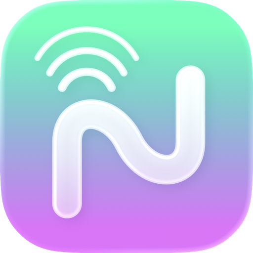
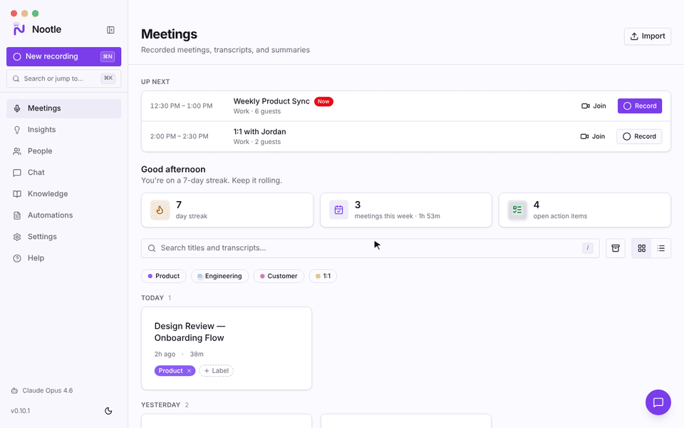

<p align="center">
  
</p>

<h1 align="center">Nootle</h1>

<p align="center">
  <strong>The open-source, local-first AI meeting notetaker for Mac</strong>
  <br />
  Record any call without a bot, transcribe it on your Mac, and get summaries, action items, and answers with the AI you choose. A free, MIT-licensed alternative to Granola, Otter, and Fireflies.
</p>

<p align="center">
  <code>brew tap michellemayes/nootle https://github.com/michellemayes/nootle && brew install --cask nootle</code>
</p>

<p align="center">
  <a href="https://github.com/michellemayes/nootle/releases"></a>
  <a href="https://github.com/michellemayes/nootle/actions"></a>
  <a href="https://github.com/michellemayes/nootle/blob/main/LICENSE"></a>
  
</p>

---

<p align="center">
  
</p>

Nootle records your meetings (microphone and system audio), transcribes them on your Mac with speaker names, and lets you ask an AI about what was said. Point it at your project folders and it answers from those too, even live during a call.

**Private by default.** Recording and transcription happen on your Mac, and audio is never uploaded. Summaries and chat use the AI you pick: a local Ollama model keeps everything on-device, or bring an OpenAI, Anthropic, Google, Groq, OpenRouter or Bedrock key, or your Claude or ChatGPT subscription through the Claude Code or Codex CLI. **Local-only mode** (Settings → Privacy) allows only local models. There's no telemetry. Nootle only goes online for things you set up, plus model downloads and update checks.

## Features

- **No bot in the call.** Records mic and system audio from Zoom, Meet, Teams, or anything else, and can pop up when a call starts.
- **Live transcript with speakers.** Transcribed on your Mac with Parakeet. Speakers are told apart and named from the call's video tiles. Nootle can also learn voices and recognize them in later meetings.
- **Summaries and action items.** Every meeting is summarized when it ends, with templates you choose. Decisions and action items are collected across meetings.
- **Pre-meeting brief.** A few minutes before a calendar meeting: who's coming, open action items, last time's decisions, and related docs (opt-in).
- **Live Assist.** During a call, answers questions from your documents and past meetings, including ones it hears asked aloud.
- **Ask the Room.** Listen to a meeting as a short spoken recap, each point in the voice of whoever raised it, made on your Mac. Then type a question and hear the answer in their voice.
- **Ask your meetings and docs.** Chat across every meeting and your knowledge base (PDF, Word, PowerPoint, Excel, web pages and more), with citations.
- **Meeting Coach (opt-in).** A private card after each call on how you showed up (talk share, interruptions, questions, filler words, pace), with trends over time.
- **Your notes, expanded.** Jot shorthand while recording. Nootle fills it out from the transcript afterwards.
- **Snapshots.** Captures shared slides and screens into your notes, and reads the text on them.
- **Workflows.** Send recaps and action items to Slack, Notion, Linear, GitHub, Asana, Confluence, Obsidian, or email.
- **Share links.** End-to-end encrypted `nootle.ai` links to a meeting's notes.
- **Built for agents.** A CLI and an MCP server (with a read-only mode) give Claude Code and other agents your meetings.
- **Plain files you own.** Export any meeting, or all of them, as Markdown, text, SRT or WebVTT. Import recordings and transcripts from Otter, Fathom, Granola, Zoom, Teams and Meet.

See [every feature in detail](docs/features.md).

## Why Nootle

| | Nootle | Granola | Otter | Meetily |
|---|---|---|---|---|
| Records without a bot joining the call | ✅ | ✅ | Desktop app only | ✅ |
| Transcription on your Mac | ✅ | ❌ | ❌ | ✅ |
| Tells speakers apart, remembers names | ✅ free | "Me / Them" on desktop | ✅ | Pro |
| Any AI, including local models (Ollama) or your Claude / ChatGPT subscription | ✅ | ❌ | ❌ | ✅ |
| Full history as plain files you own | ✅ | Limited free history; encrypted local cache | Paid plans | ✅ |
| Answers from your own docs, live in the call (local knowledge base) | ✅ | ❌ | ❌ | ❌ |
| MCP server and CLI for agents | ✅ (read-only mode available) | MCP on paid plans | MCP (enterprise) | — |
| Open source | ✅ MIT | ❌ | ❌ | Open core |
| Price | Free | Free / $14 a month | Free / from $8.33 a month | Free / about $10 a month |

Competitor details are as of October 2026 and change often; check their sites.


## Install

```bash
brew tap michellemayes/nootle https://github.com/michellemayes/nootle
brew install --cask nootle
```

Or download the latest `.dmg` from [Releases](https://github.com/michellemayes/nootle/releases). Nootle needs an Apple Silicon Mac (M1–M5) on macOS 14 or later. It updates itself from inside the app.

On first launch it asks for **Microphone**, **Screen Recording** (for system audio and Snapshots), and optionally **Calendar** (to name recordings after events).

> On v0.1.15 or earlier, in-app updates fail. Download the latest `.dmg` and drag it over the old app once.

## CLI and MCP server

`nootle-cli` ships inside the app. Add Nootle to Claude Code as an MCP server:

```bash
claude mcp add --scope user nootle -- /Applications/Nootle.app/Contents/MacOS/nootle-cli mcp
```

Add `--read-only` to the end to stop agents editing or sending anything. The [CLI, MCP and URL scheme guide](docs/cli.md) covers every command.

## Development

```bash
pnpm install
pnpm tauri dev
```

[docs/development.md](docs/development.md) covers tests, releases, and how integration sign-in works.

## License

[MIT](LICENSE)
